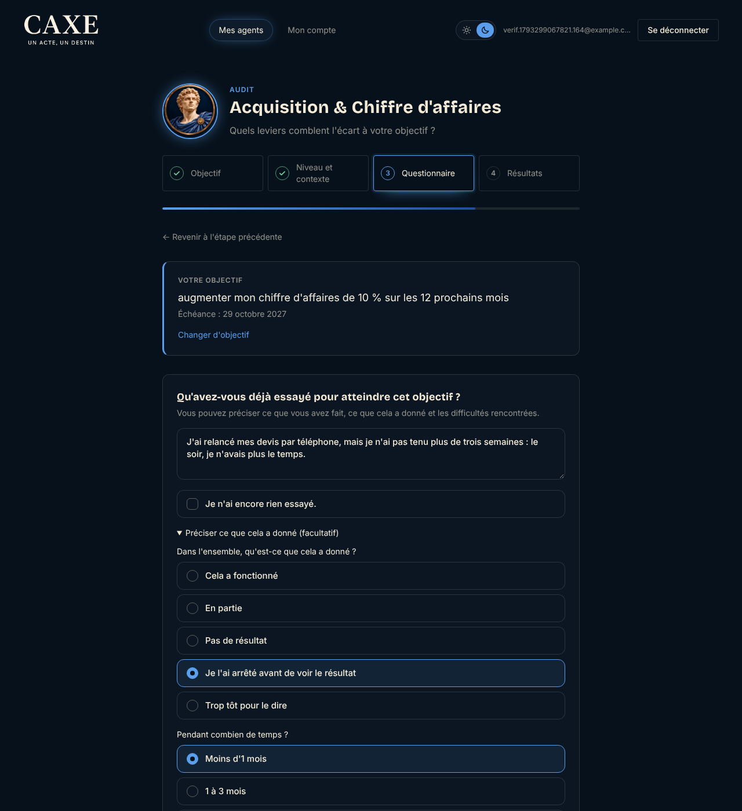
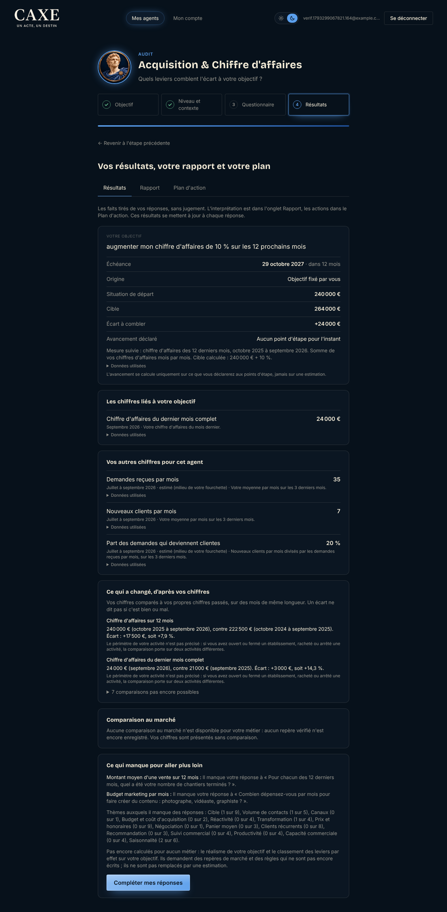
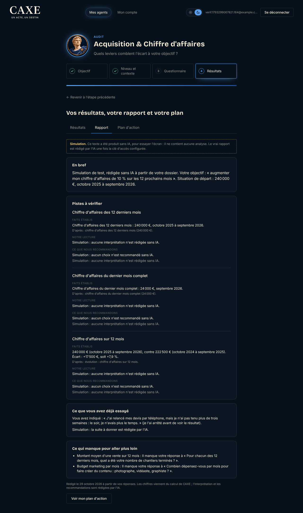
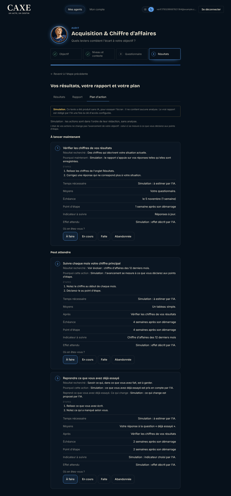

# Exemple complet : de l'objectif au plan d'action

**Profil fictif, chiffres fictifs.** Aucun vrai client. Produit le 29 octobre 2026 par `node scripts/verification/exemple-complet.mjs`,
sur le serveur de test, avec de vraies captures de l'application.

**Le rapport et le plan de cet exemple sont une simulation** : texte de test produit sans IA, faute de clé d'API dans l'environnement.
Ils montrent l'écran, l'enregistrement et les contrôles, pas la qualité d'un conseil. Le dossier, lui, est exactement celui que l'IA
recevrait (`exemple/dossier.json`).

## Le profil

- **Électricien fictif**, 4 personnes, zone périurbaine, entreprise créée en mars 2019.
- Agents souscrits : Acquisition & Chiffre d'affaires, Finance & Rentabilité.
- Chiffre d'affaires déclaré au dossier : environ 20 000 € par mois.

## 1. L'objectif, puis ce qui a déjà été essayé

- **Objectif** (Acquisition, écrit librement) : « augmenter mon chiffre d'affaires de 10 % sur les 12 prochains mois », échéance le
  29 octobre 2027.
- **Déjà essayé**, juste sous l'objectif : « J'ai relancé mes devis par téléphone, mais je n'ai pas tenu plus de trois semaines : le
  soir, je n'avais plus le temps. »
  - Résultat : « Je l'ai arrêté avant de voir le résultat ».
  - Durée : « Moins d'1 mois ».

## 2. Les réponses (extrait)

- Chiffre d'affaires de chacun des 12 derniers mois :
  - 12 derniers mois : de 15 000 € à 24 000 € par mois, 240 000 € au total ;
  - les mêmes 12 mois un an plus tôt : 222 500 €.
- Demandes reçues par mois : « entre 30 et 40 » (estimation).
- Nouveaux clients par mois : 7.
- Zone où se fait le plus de chiffre d'affaires (réponse libre) : « Surtout dans les communes autour de Villefranche, moins en ville. »

## 3. Résultats : les faits

Ce que l'écran calcule, sans score, sans couleur et sans conseil :

- **Situation de départ** : 240 000 € (octobre 2025 à septembre 2026). **Cible** : 264 000 € (240 000 € + 10 %).
  **Écart à combler** : +24 000 €.
- **Chiffres liés à l'objectif** : chiffre d'affaires du dernier mois complet, 24 000 € (septembre 2026).
- **Autres chiffres de l'agent** :
  - demandes reçues par mois : 35, estimé (milieu de la fourchette) ;
  - nouveaux clients par mois : 7 ;
  - part des demandes qui deviennent clientes : 20 %, estimé.
- **Évolutions** :
  - chiffre d'affaires sur 12 mois : 240 000 € contre 222 500 €, soit +17 500 € (+7,9 %) ;
  - dernier mois : 24 000 € contre 21 000 €, soit +3 000 € (+14,3 %).

  Les autres comparaisons disent ce qui manque.
- **Marché** : aucun repère vérifié enregistré ; la comparaison est dite indisponible.
- **Ce qui manque** : par exemple le montant moyen d'une vente (le nombre de chantiers terminés par mois n'est pas renseigné).

Sur téléphone : [`2-resultats-telephone-360.png`](exemple/2-resultats-telephone-360.png).

## 4. Le dossier transmis à l'IA

`exemple/dossier.json`, sans nom, e-mail, raison sociale ni ville.

- **Objectif (O)** : phrase, changement visé +10 %, mesure F1, départ, cible, écart.
- **Faits** :
  - F1 : chiffre d'affaires des 12 derniers mois ;
  - F2 : chiffre d'affaires du dernier mois complet ;
  - F3 : demandes, estimé ;
  - F4 : nouveaux clients ;
  - F5 : part des demandes qui deviennent clientes.
- **Évolutions** : E4 et E5 établies ; E1 à E3 et E6 à E9 non établies, avec la raison de chacune.
- **Déjà essayé (T)** : statut `essaye`, texte, résultat, durée.
- **Réponse libre (L1)** : la zone.
- **Constat** : aucun levier signalé par le moteur (seuils non écrits), ce que les consignes disent à l'IA.

Une IA qui suit ses consignes devrait notamment :
- partir de l'écart de +24 000 € et de la hausse déjà constatée sur un an ;
- lire l'essai comme un problème de tenue dans la durée (« le soir, je n'avais plus le temps »), pas comme une méthode qui a échoué ;
- proposer de reprendre les relances autrement (moment fixe, forme plus courte), avec ce qui change ;
- ne pas juger la part de 20 % sans repère ;
- dire ce qui manque (nombre de chantiers, devis).

**Cela n'a pas été vérifié** : aucun appel réel n'a été fait.

## 5. Le rapport et le plan (simulation)

Le rapport simulé reprend les faits du dossier, cite ce qui a été essayé sous « Ce que vous avez déjà essayé » et liste ce qui
manque. Chaque passage d'analyse dit « Simulation : … », et le bandeau en tête l'annonce.

Le plan simulé compte trois actions :

| Action | Quand | Remarque |
|---|---|---|
| Vérifier les chiffres de vos résultats | maintenant | |
| Suivre chaque mois votre chiffre principal | ensuite | |
| Reprendre ce que vous avez déjà essayé | ensuite | marquée comme reprise d'un essai, avec « ce qui change » |

Chaque action se suit : à faire, en cours, faite, abandonnée. Ces actions sont des textes de test, pas des recommandations.

Sur téléphone : [`3-rapport-telephone-360.png`](exemple/3-rapport-telephone-360.png),
[`4-plan-telephone-360.png`](exemple/4-plan-telephone-360.png).

## 6. Pour refaire l'exemple avec l'IA

1. Mettre `ANTHROPIC_API_KEY` dans l'environnement du serveur et retirer `RAPPORT_MODE=simulation`.
2. Lancer `node scripts/verification/exemple-complet.mjs`.

Le rapport est alors rédigé par `claude-opus-5-5`, contrôlé par le code, puis enregistré avec son journal (`Rapport.journal` : essais,
défauts relevés, sections retirées, jetons).
